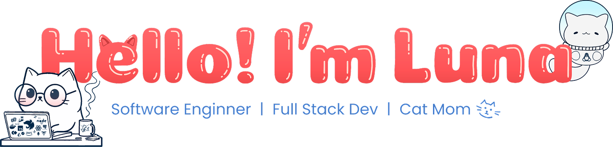
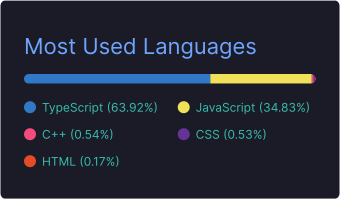

<!-- Cover Banner -->
<picture>
  <source media="(prefers-color-scheme: dark)" srcset="assets/banners/banner_dark.png">
  <source media="(prefers-color-scheme: light)" srcset="assets/banners/banner_light.png">
  
</picture>

 
 

<!-- Personal description -->

  🌟 Full Stack Developer in training, studying <strong>Systems Development at SENAI</strong> and pursuing a <strong>Bachelor's Degree in Software Engineering</strong>, with experience in real-world projects. Passionate about technology and learning new things, focused on improving my programming skills and creating efficient solutions, exploring new areas of IT and applying modern practices, always <strong>turning coffee into smart solutions</strong>.

<!-- SECTION: 💫 About me -->
<picture>
  <source media="(prefers-color-scheme: dark)" srcset="assets/headers/dark/about-me.png">
  <source media="(prefers-color-scheme: light)" srcset="assets/headers/light/about-me.svg">
  
</picture>
<!-- Divider -->
<picture>
  <source media="(prefers-color-scheme: dark)" srcset="/assets/dividers/dark-divider.svg">
  <source media="(prefers-color-scheme: light)" srcset="/assets/dividers/light-divider.svg">
  
</picture>

- 💻 **Full Stack Developer** | React • NestJS • TypeScript
- 🏗️ Building modern applications with **REST APIs** and databases
- 🌱 Constantly evolving, exploring new technologies and best practices
- 🎨 Prototyping and UI/UX Design with Figma
- ✨ Passionate about **clean code** and coffee ☕

 
 

<a href="https://git.io/typing-svg">
  <picture>
    <source media="(prefers-color-scheme: dark)" srcset="https://readme-typing-svg.demolab.com?font=Fira+Code&size=18&pause=1000&color=FFFFFF&width=435&lines=.+%DC%81%E2%82%8A+%E2%8A%B9+.+%DC%81+%E2%9F%A1+%DC%81+.+%E2%8A%B9+%E2%82%8A+%DC%81.%E2%9D%80+%E2%8B%86;%E2%8A%B9+%E0%A3%AA%CB%96+%EF%B9%8F%F0%93%8A%9D%EF%B9%8F%F0%93%82%81%EF%B9%8F%EF%B9%8F%DC%81+%E2%8A%B9+%E0%A3%AA+%CB%96">
    <source media="(prefers-color-scheme: light)" srcset="https://readme-typing-svg.demolab.com?font=Fira+Code&size=18&pause=1000&color=1F2328&width=435&lines=.+%DC%81%E2%82%8A+%E2%8A%B9+.+%DC%81+%E2%9F%A1+%DC%81+.+%E2%8A%B9+%E2%82%8A+%DC%81.%E2%9D%80+%E2%8B%86;%E2%8A%B9+%E0%A3%AA%CB%96+%EF%B9%8F%F0%93%8A%9D%EF%B9%8F%F0%93%82%81%EF%B9%8F%EF%B9%8F%DC%81+%E2%8A%B9+%E0%A3%AA+%CB%96">
    
  </picture>
</a>

 

<!-- SECTION: ⚡ Skills & Technologies -->
<picture>
  <source media="(prefers-color-scheme: dark)" srcset="assets/headers/dark/tech-stack.png">
  <source media="(prefers-color-scheme: light)" srcset="assets/headers/light/tech-stack.svg">
  
</picture>
<!-- Divider -->
<picture height="1px">
  <source media="(prefers-color-scheme: dark)" srcset="/assets/dividers/dark-divider.svg">
  <source media="(prefers-color-scheme: light)" srcset="/assets/dividers/light-divider.svg">
  
</picture>

### Main Stack

<!-- Linguagens -->
### Programming Languages

<!-- Frontend & Frameworks -->
### Frontend & Frameworks

<!-- Bancos de Dados -->
### Databases & Infra

<!-- Ferramentas -->
### Tools & IDEs

##

<!-- SECTION: 🌱 GitHub Status -->

  <picture>
    <source media="(prefers-color-scheme: dark)" srcset="assets/headers/dark/github-status.png">
    <source media="(prefers-color-scheme: light)" srcset="assets/headers/light/github-status.svg">
    
  </picture>

  
  
  

##

<!-- SECTION: 🌸 Footer -->

  

   
  
  **Thank you for visiting my profile!**  
  **Feel free to explore my projects and connect with me!** ✨

<!-- SECTION: 🔗 Contacts -->

  <!-- Instagram -->
  

  <!-- LinkedIn -->
  

  <!-- Telegram -->
  

  <!-- Gmail -->
  

   

  <!-- WhatsApp -->
  

